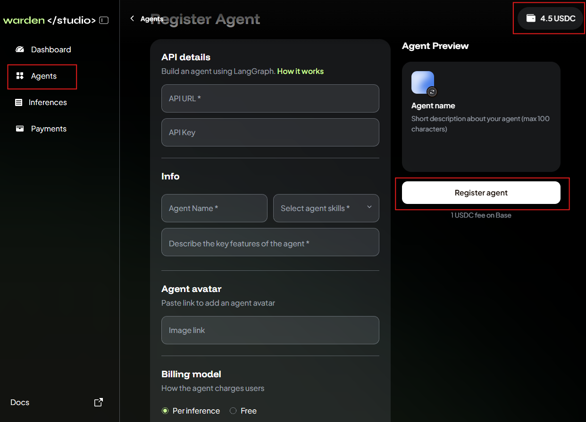

# Warden Community Agents

This is a collection of **Warden Community Agents and Tools** built with TypeScript or Python.

💫 The [Agent Builder Incentive Programme](https://wardenprotocol.org/blog/agent-builder-incentive-programme) is live! Register now and get paid for building agents—up to $10,000 for each agent in the top 10 published in the first month.

To qualify for rewards, you need to do the following:

- [Register for the programme](https://docs.google.com/forms/d/e/1FAIpQLSdwTR0BL8-T3LLbJt6aIyjuEYjMAmJPMdwffwHcyW6gskDQsg/viewform)
- Explore our examples and build your own agent meeting the [requirements](#technical-requirements)
- Publish your agent on Warden through [Warden Studio](#publish-your-agent)
- Submit a PR, listing your agent in this README, under [Community Agents and Tools](#-community-agents-and-tools).

## 📚 Documentation

All documentation can be found in the [`docs/`](docs) directory.

If you get stuck or you need to get in touch, join the [`#developers`](https://discord.com/channels/1199357852666560654/1222892775876333629) channel on our [Discord server](https://discord.gg/wardenprotocol).

## 🤖 Example Agents

Each agent in the [`agents/`](agents) directory is completely self-sufficient and comes with its own:
- Dependencies and devDependencies
- Configuration files
- Build scripts
- Tests  (excluding starter templates)

The following agents are available:

- **[langgraph-quick-start](agents/langgraph-quick-start)**: LangGraph starter template in TypeScript (easiest)
- **[langgraph-quick-start-py](agents/langgraph-quick-start-py)**: LangGraph starter template in Python (easiest)
- **[weather-agent](agents/weather-agent)**: Beginner-friendly weather agent (less complex) **<- recommended for new agent developers**
- **[coingecko-agent](agents/coingecko-agent)**: CoinGecko agent for cryptocurrency data analysis (more complex)
- **[portfolio-agent](agents/portfolio-agent)**: Portfolio agent for cryptocurrency wallet performance analysis (more complex)

## Technical Requirements

When building your agent for the incentive programme, you can implement any Web3 or Web2 workflow and any custom functionality. Your Agent can connect to APIs, use databases, tools, and so on.

**To qualify for rewards**, please keep in mind the following requirements and technical limitations:

- Currently, you must use [LangGraph](https://www.langchain.com/langgraph). Support for more frameworks is coming soon.
- You can host your Agent on LangGraph Cloud or on your own infrastructure. ([learn more](docs/deploy-an-agent.md)).
- Make sure that your agent is accessible through an API. **No UI is required**.
- Make sure that you only have one Agent per LangGraph instance to keep your Agents separated.
- For security reasons, agents will not have access to users' wallets, nor will they be able to store any data on Warden infrastructure. These limitations will be removed in the next phase of the Warden Agent Hub.

> [!IMPORTANT]
> To publish your Agent, you **do not need to build a UI**. The only thing required is an **API URL**, which is **automatically available** once you deploy your Agent.

## Publish Your Agent

After deploying your agent, publish it through [Warden Studio](https://studio.wardenprotocol.org)—our platform for agent developers.

Provide the following information:

- Your agent's API URL and API key
- The name, description, skills, and avatar
- The preferred billing model (per inference or free)

> [!IMPORTANT]
> Make sure your Warden account holds at least **1 USDC on Base** to pay the registration fee and **ETH on Base** to pay the gas fee. The developer account in Warden Studio automatically connects with your Warden account using the same credentials.

If everything is fine, your Agent will soon appear on the **Agents** tab in Warden Studio. You'll also see the Agent on [Warden](https://app.wardenprotocol.org/auth): just open the **Agent Hub** and check the **Community** tab.

## 🌟 Community Agents and Tools

Awesome agents and tools built by the community! Add yours by submitting a PR to this README file.

**Format:** `[Project Name](link): Short agent description`

### Agents

- [Travel DeFi Agent](https://github.com/Joshua15310/travel-defi-agent): LangGraph agent for travel planning and expense optimization using Gemini AI and DeFi strategies.
- [Cross-Chain Yield Intelligence Agent](https://github.com/rudazy/warden-yield-agent): AI agent that finds and ranks the best DeFi yield opportunities across 7 blockchain networks
- [Portfolio Manager Agent](https://github.com/0xnald/portfolio-manager-agent): AI-powered crypto portfolio agent that adapts allocations in real time based on market data and natural language inputs
- [Web3 ICO & Funding Tracker Agent](https://github.com/Mrgtee/web3-ico-funding-tracker): An AI agent for tracking Web3 funding rounds, ICOs, TGEs, token claims, and crypto news from live sources
- [Hyperliquid Agent](https://github.com/sudeepb02/hyperliquid-agent-warden): An AI-powered agent that analyzes funding rates on the Hyperliquid perpetual futures exchange. Get real-time funding rate data, identify arbitrage opportunities, and understand market trends.

### Tools & Resources

- [Your Tool](https://github.com/username/repo): Description of what your tool does
